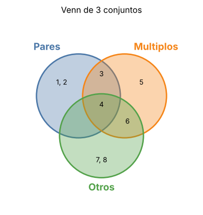
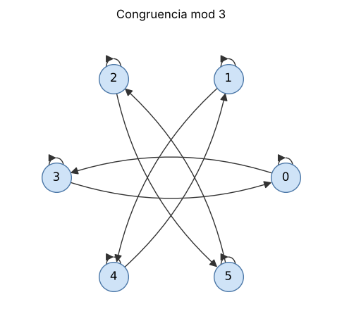
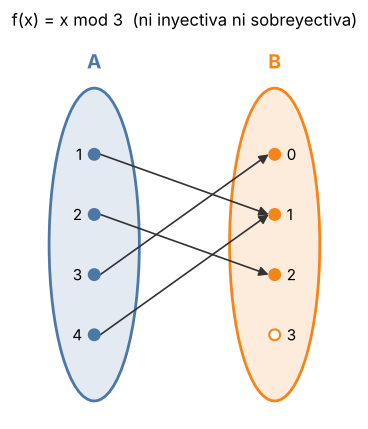
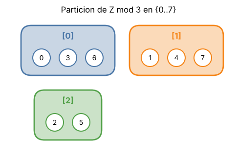
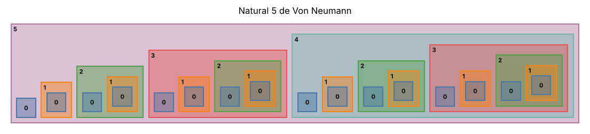

# teoria-conjuntos-toolkit

Librería de Python para **Teoría de Conjuntos**: conjuntos, familias, relaciones, funciones, equivalencia y particiones, con visualización incluida.



## Características

- **Conjuntos** inmutables y hashables: unión, intersección, diferencia, complemento, potencia y producto cartesiano.
- **Familias de conjuntos**: unión e intersección generalizadas, recubrimientos y naturales de Von Neumann.
- **Relaciones**: reflexiva, simétrica, antisimétrica, transitiva, orden, equivalencia, cerraduras (Warshall), inversa y composición.
- **Funciones**: inyectiva, sobreyectiva, biyectiva, inversa y composición.
- **Equivalencia y particiones**: clases, generación y validación de particiones.
- **Gráficos**: diagrama de Venn, grafo de relación, diagrama sagital, particiones como islas y árbol de Von Neumann.
- Validación de entradas y excepciones propias con mensajes claros.

## Instalación

Requiere Python 3.9 o superior.

```bash
git clone https://github.com/SoulOfCinderTomas/Proy_Prog_LB_2026_2.git
cd Proy_Prog_LB_2026_2
python -m venv .venv
source .venv/bin/activate        # Windows: .venv\Scripts\activate
pip install -e ".[dev]"
```

## Uso rápido

```python
from teoria_conjuntos_toolkit import (
    Conjunto, Relacion, Funcion, generar_particion, diagrama_venn,
)

a = Conjunto([1, 2, 3, 4])
b = Conjunto([3, 4, 5, 6])
print(a.union(b))            # {1, 2, 3, 4, 5, 6}
print(a.interseccion(b))     # {3, 4}
print(a.cardinal)            # 4

congruencia = Relacion.desde_predicado(range(7), lambda x, y: (x - y) % 3 == 0)
print(congruencia.es_relacion_equivalencia())   # True
print(generar_particion(congruencia))           # [{0, 3, 6}, {1, 4}, {2, 5}]

f = Funcion.desde_regla([1, 2, 3], lambda x: x * 2, [2, 4, 6])
print(f.es_biyectiva(), f.funcion_inversa().pares)

diagrama_venn([a, b], nombres=["A", "B"])
```

Más ejemplos: [`examples/ejemplos_uso.py`](examples/ejemplos_uso.py) (consola) y [`examples/prueba_graficos.py`](examples/prueba_graficos.py) (gráficos, abre ventanas de matplotlib).

## Gráficos

| Grafo de relación | Diagrama sagital |
|---|---|
|  |  |

| Partición (islas) | Naturales de Von Neumann |
|---|---|
|  |  |

## Documentación

La referencia completa de la API y las decisiones de diseño están en [`docs/docs.md`](docs/docs.md).

## Pruebas

```bash
pytest
pytest --cov=teoria_conjuntos_toolkit
```

## Estructura

```
src/teoria_conjuntos_toolkit/   código de la librería
tests/                          pruebas unitarias
examples/                       ejemplos de uso
docs/                           documentación e imágenes
```

## Contribuir

Flujo de ramas: `feature/*` → `dev` → `main`, con [commits convencionales](https://www.conventionalcommits.org/es/) (`feat:`, `fix:`, `docs:`, `test:`, `refactor:`, `chore:`). Cada función documenta su **Entrada**, **Salida** y una descripción corta.

## Licencia

MIT. Ver [`LICENSE`](LICENSE).
