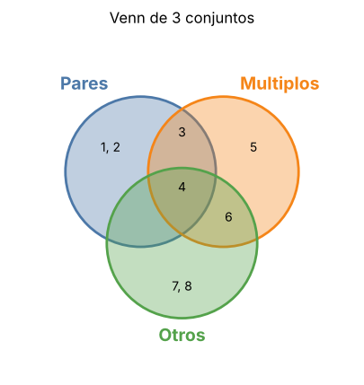
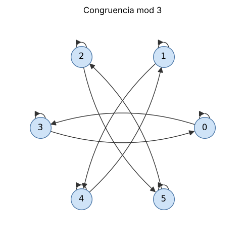
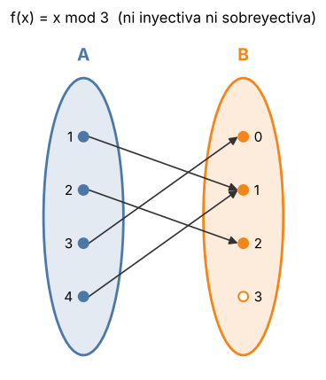
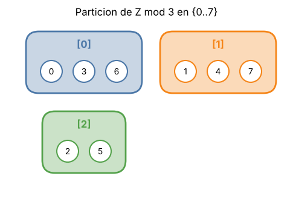
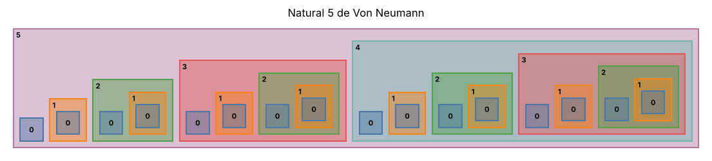

# Documentación de teoria-conjuntos-toolkit

Referencia completa de la librería. Para una introducción rápida ve al [README](../README.md).

## Contenido

1. [Instalación](#instalación)
2. [Estructura del paquete](#estructura-del-paquete)
3. [Decisiones de diseño](#decisiones-de-diseño)
4. [Referencia de la API](#referencia-de-la-api)

## Instalación

```bash
python -m venv .venv
source .venv/bin/activate        # Windows: .venv\Scripts\activate
pip install -e ".[dev]"
pytest
```

`matplotlib` y `networkx` son dependencias obligatorias: se instalan solas con el paquete.

## Estructura del paquete

| Módulo | Qué contiene | Tipo de proceso |
|---|---|---|
| `conjunto.py` | `Conjunto`, operaciones, cardinal, potencia, producto cartesiano | analítico / numérico |
| `familia.py` | `FamiliaDeConjuntos`, operaciones generalizadas, naturales de Von Neumann | analítico |
| `relacion.py` | `Relacion`, propiedades, cerraduras (Warshall), inversa, composición | analítico / numérico |
| `funcion.py` | `Funcion`, clasificación, inversa, composición | analítico |
| `equivalencia.py` | clases de equivalencia, particiones y su validación | analítico |
| `graphic.py` | Venn, grafo de relación, diagrama sagital, islas, árbol de Von Neumann | gráfico |
| `exceptions.py` | jerarquía de excepciones propias | validación |
| `utils.py` | validadores internos reutilizables | soporte |

## Decisiones de diseño

- **Inmutabilidad.** `Conjunto`, `Relacion` y `Funcion` no cambian después de crearse. Por eso son hashables y un conjunto puede contener a otros conjuntos (necesario para el conjunto potencia y los naturales de Von Neumann).
- **Familias indexadas.** `FamiliaDeConjuntos` conserva el orden y admite repetidos, como una familia `{Aᵢ}` indexada.
- **Naturales de Von Neumann.** `0 = ∅` y `S(x) = x ∪ {x}`. Un conjunto finito no puede ser inductivo, por eso se ofrece `es_natural_von_neumann` y no un `es_conjunto_inductivo`.
- **Relación vs función.** `Relacion.inversa()` siempre existe; `Funcion.funcion_inversa()` solo existe si la función es biyectiva y si no lanza `NoBiyectivaError`.
- **Composición.** `S.composicion(R)` es S∘R (primero R, luego S).
- **Equivalencia ↔ partición.** `generar_particion` y `relacion_desde_particion` implementan el teorema que las relaciona y son inversas entre sí.
- **Validación y errores.** Toda entrada se valida al inicio. Todas las excepciones heredan de `TeoriaConjuntosError` y además de `ValueError` o `TypeError`, así que `except ValueError` también funciona.
- **Gráficos seguros.** Las funciones de `graphic.py` validan antes de crear la figura, así que un error no deja figuras abiertas. Aceptan un `ax` de matplotlib y el árbol de Von Neumann se limita a `n ≤ 6`.
- **Código sin repetición.** Lo reutilizable vive en funciones atómicas: `validar_relacion`, `es_homogenea`, `warshall`, `a_frozenset`, `validar_natural`.

## Ejemplos gráficos

| | |
|---|---|
|  |  |
|  |  |
|  | |

# Referencia de la API

Generada a partir de los docstrings del código.

## Conjunto

Módulo `conjunto.py`.

### Clase `Conjunto`

#### `__init__(self, elementos: Iterable[Any]=()) -> None`

Construye un conjunto finito, inmutable y hashable.

- **Entrada:** elementos (iterable), elementos del conjunto; los repetidos se ignoran (no cadenas, no elementos no hashables).
- **Salida:** None, crea el Conjunto. Lanza ConjuntoInvalidoError o ElementoNoHashableError si los datos no son válidos.

#### `elementos(self) -> frozenset`

(propiedad) Da acceso al frozenset subyacente.

- **Entrada:** ninguna.
- **Salida:** frozenset, elementos del conjunto.

#### `cardinal(self) -> int`

(propiedad) Calcula el número de elementos |A|.

- **Entrada:** ninguna.
- **Salida:** int, cantidad de elementos.

#### `es_vacio(self) -> bool`

Indica si el conjunto es el conjunto vacío.

- **Entrada:** ninguna.
- **Salida:** bool, True si no tiene elementos.

#### `es_subconjunto(self, otro: Iterable[Any]) -> bool`

Evalúa si A ⊆ B.

- **Entrada:** otro (iterable), conjunto B.
- **Salida:** bool, True si todo elemento de A está en B.

#### `es_subconjunto_propio(self, otro: Iterable[Any]) -> bool`

Evalúa si A ⊂ B (subconjunto y distinto).

- **Entrada:** otro (iterable), conjunto B.
- **Salida:** bool, True si A ⊆ B y A ≠ B.

#### `es_disjunto(self, otro: Iterable[Any]) -> bool`

Evalúa si A ∩ B = ∅.

- **Entrada:** otro (iterable), conjunto B.
- **Salida:** bool, True si no comparten elementos.

#### `union(self, *otros: Iterable[Any]) -> 'Conjunto'`

Calcula A ∪ B ∪ ... con uno o varios conjuntos.

- **Entrada:** otros (iterables), conjuntos a unir con A.
- **Salida:** Conjunto, unión de todos.

#### `interseccion(self, *otros: Iterable[Any]) -> 'Conjunto'`

Calcula A ∩ B ∩ ... con uno o varios conjuntos.

- **Entrada:** otros (iterables), conjuntos a intersectar con A.
- **Salida:** Conjunto, intersección de todos.

#### `diferencia(self, otro: Iterable[Any]) -> 'Conjunto'`

Calcula A − B.

- **Entrada:** otro (iterable), conjunto B.
- **Salida:** Conjunto, elementos de A que no están en B.

#### `diferencia_simetrica(self, otro: Iterable[Any]) -> 'Conjunto'`

Calcula A △ B.

- **Entrada:** otro (iterable), conjunto B.
- **Salida:** Conjunto, elementos que están en exactamente uno de los dos.

#### `complemento(self, universo: Iterable[Any]) -> 'Conjunto'`

Calcula el complemento de A respecto a un universo U.

- **Entrada:** universo (iterable), conjunto U que contiene a A.
- **Salida:** Conjunto, U − A. Lanza UniversoInvalidoError si A no está contenido en U.

#### `conjunto_potencia(self) -> 'Conjunto'`

Calcula P(A), el conjunto de todos los subconjuntos de A.

- **Entrada:** ninguna.
- **Salida:** Conjunto, de conjuntos, con 2^|A| elementos. Lanza ConjuntoDemasiadoGrandeError si |A| supera LIMITE_POTENCIA.

### `como_conjunto(objeto: Iterable[Any]) -> Conjunto`

Convierte un iterable en Conjunto; es la única puerta de validación de datos.

- **Entrada:** objeto (iterable), datos a convertir (si ya es Conjunto se devuelve igual).
- **Salida:** Conjunto, equivalente al objeto recibido.

### `union_generalizada(conjuntos: Iterable[Iterable[Any]]) -> Conjunto`

Calcula la unión de una colección de conjuntos.

- **Entrada:** conjuntos (iterable de iterables), colección de conjuntos a unir.
- **Salida:** Conjunto, unión de todos; la unión de una colección vacía es ∅.

### `interseccion_generalizada(conjuntos: Iterable[Iterable[Any]], universo: Optional[Iterable[Any]]=None) -> Conjunto`

Calcula la intersección de una colección de conjuntos.

- **Entrada:** conjuntos (iterable de iterables), colección a intersectar; universo (iterable, opcional), solo se usa si la colección está vacía.
- **Salida:** Conjunto, intersección de todos (el universo si la colección está vacía). Lanza FamiliaVaciaError si está vacía y no hay universo.

### `producto_cartesiano(*conjuntos: Iterable[Any]) -> Conjunto`

Calcula el producto cartesiano A₁ × A₂ × ... × Aₙ.

- **Entrada:** conjuntos (iterables), uno o más conjuntos a multiplicar.
- **Salida:** Conjunto, de tuplas con un elemento de cada conjunto. Lanza OperacionInvalidaError si no se recibe ninguno.

## Familias de conjuntos

Módulo `familia.py`.

### Clase `FamiliaDeConjuntos`

#### `__init__(self, conjuntos: Iterable[Iterable[Any]]=()) -> None`

Construye una familia indexada de conjuntos que conserva orden y repetidos.

- **Entrada:** conjuntos (iterable de iterables), miembros de la familia; cada uno se convierte a Conjunto.
- **Salida:** None, crea la familia. Lanza FamiliaInvalidaError si no es iterable, es una cadena o algún miembro no es válido.

#### `conjuntos(self) -> tuple`

(propiedad) Da acceso a los miembros de la familia.

- **Entrada:** ninguna.
- **Salida:** tuple, conjuntos de la familia en orden.

#### `__getitem__(self, indice: int) -> Conjunto`

Obtiene el miembro en una posición.

- **Entrada:** indice (int), posición del miembro.
- **Salida:** Conjunto, miembro en esa posición.

#### `union(self) -> Conjunto`

Calcula la unión generalizada de la familia.

- **Entrada:** ninguna.
- **Salida:** Conjunto, unión de todos los miembros; ∅ si la familia es vacía.

#### `interseccion(self, universo: Optional[Iterable[Any]]=None) -> Conjunto`

Calcula la intersección generalizada de la familia.

- **Entrada:** universo (iterable, opcional), solo se usa si la familia es vacía.
- **Salida:** Conjunto, intersección de todos los miembros. Lanza FamiliaVaciaError si la familia es vacía y no hay universo.

#### `es_disjunta_dos_a_dos(self) -> bool`

Evalúa si todo par de miembros en posiciones distintas es disjunto.

- **Entrada:** ninguna.
- **Salida:** bool, True si ningún par de miembros comparte elementos.

#### `recubre(self, universo: Iterable[Any]) -> bool`

Evalúa si la familia cubre un universo, es decir U ⊆ ⋃ Aᵢ.

- **Entrada:** universo (iterable), conjunto U a cubrir.
- **Salida:** bool, True si todo elemento de U está en algún miembro.

#### `es_particion_de(self, universo: Iterable[Any]) -> bool`

Evalúa si la familia es una partición de un universo.

- **Entrada:** universo (iterable), conjunto U a particionar.
- **Salida:** bool, True si los miembros son no vacíos, disjuntos dos a dos y su unión es U.

### `sucesor(conjunto: Iterable[Any]) -> Conjunto`

Calcula el sucesor S(x) = x ∪ {x}.

- **Entrada:** conjunto (iterable), conjunto x.
- **Salida:** Conjunto, x ∪ {x}.

### `numero_von_neumann(n: int) -> Conjunto`

Construye el natural n como conjunto, con 0 = ∅ y n+1 = S(n).

- **Entrada:** n (int), natural a construir (entero >= 0).
- **Salida:** Conjunto, natural n de Von Neumann con n elementos. Lanza NaturalInvalidoError si n no es un entero >= 0.

### `naturales_von_neumann(n: int) -> FamiliaDeConjuntos`

Construye los naturales 0, 1, ..., n de Von Neumann (n inclusive).

- **Entrada:** n (int), último natural a construir (entero >= 0); para imprimir o graficar conviene n <= 10.
- **Salida:** FamiliaDeConjuntos, con los n+1 naturales en orden. Lanza NaturalInvalidoError si n no es un entero >= 0.

### `es_natural_von_neumann(conjunto: Iterable[Any]) -> bool`

Evalúa si un conjunto es exactamente el natural |x| de Von Neumann.

- **Entrada:** conjunto (iterable), conjunto x a verificar.
- **Salida:** bool, True si x = {0, 1, ..., |x| − 1}.

## Relación

Módulo `relacion.py`.

### `validar_pares(pares: Iterable[Any], dominio: Conjunto, codominio: Conjunto) -> Conjunto`

Valida que una colección sea un conjunto de pares ordenados de dominio × codominio.

- **Entrada:** pares (iterable), pares (a, b) a validar; dominio (Conjunto), conjunto de las primeras componentes; codominio (Conjunto), conjunto de las segundas componentes.
- **Salida:** Conjunto, de tuplas ya validadas. Lanza RelacionInvalidaError si no son pares, si no son hashables o si alguna componente cae fuera de dominio o codominio.

### `warshall(matriz: list) -> list`

Calcula la cerradura transitiva de una matriz booleana con el algoritmo de Warshall.

- **Entrada:** matriz (list de listas de bool), matriz de adyacencia cuadrada n × n.
- **Salida:** list, nueva matriz n × n donde [i][j] es True si existe un camino de i a j; la matriz de entrada no se modifica. Lanza OperacionInvalidaError si no es cuadrada.

### `validar_relacion(objeto: Any) -> 'Relacion'`

Verifica que un objeto sea una Relacion.

- **Entrada:** objeto (Any), objeto a verificar.
- **Salida:** Relacion, el mismo objeto recibido. Lanza RelacionInvalidaError si no es una Relacion.

### Clase `Relacion`

#### `__init__(self, pares: Iterable[Any], dominio: Iterable[Any], codominio: Optional[Iterable[Any]]=None) -> None`

Construye una relación binaria R ⊆ A × B, inmutable y hashable.

- **Entrada:** pares (iterable), pares ordenados (a, b); dominio (iterable), conjunto A; codominio (iterable, opcional), conjunto B, que por defecto es A (relación sobre un conjunto).
- **Salida:** None, crea la Relacion. Lanza RelacionInvalidaError si los pares no son válidos o salen de A × B, y ConjuntoInvalidoError si dominio o codominio no son conjuntos válidos.

#### `desde_predicado(cls, dominio: Iterable[Any], predicado: Callable[[Any, Any], bool], codominio: Optional[Iterable[Any]]=None) -> 'Relacion'`

(classmethod) Construye la relación formada por los pares (a, b) que cumplen un predicado.

- **Entrada:** dominio (iterable), conjunto A; predicado (callable), función (a, b) -> bool; codominio (iterable, opcional), conjunto B, que por defecto es A.
- **Salida:** Relacion, con todos los (a, b) de A × B donde predicado(a, b) es verdadero. Lanza RelacionInvalidaError si predicado no es invocable.

#### `desde_matriz(cls, matriz: list, dominio: Iterable[Any], codominio: Optional[Iterable[Any]]=None) -> 'Relacion'`

(classmethod) Construye una relación a partir de su matriz booleana.

- **Entrada:** matriz (list de listas de bool), con una fila por elemento del dominio y una columna por elemento del codominio, ambos en orden ascendente; dominio (iterable), conjunto A; codominio (iterable, opcional), conjunto B, que por defecto es A.
- **Salida:** Relacion, con el par (aᵢ, bⱼ) cuando matriz[i][j] es verdadero. Lanza RelacionInvalidaError si las dimensiones no coinciden.

#### `dominio(self) -> Conjunto`

(propiedad) Da acceso al dominio A de la relación.

- **Entrada:** ninguna.
- **Salida:** Conjunto, conjunto A.

#### `codominio(self) -> Conjunto`

(propiedad) Da acceso al codominio B de la relación.

- **Entrada:** ninguna.
- **Salida:** Conjunto, conjunto B.

#### `pares(self) -> Conjunto`

(propiedad) Da acceso a los pares ordenados de la relación.

- **Entrada:** ninguna.
- **Salida:** Conjunto, de tuplas (a, b).

#### `imagenes(self, elemento: Any) -> Conjunto`

Calcula los elementos b tales que (a, b) ∈ R.

- **Entrada:** elemento (Any), elemento a del dominio.
- **Salida:** Conjunto, de los b relacionados con a (puede ser vacío). Lanza FueraDeDominioError si a no está en el dominio.

#### `imagen(self) -> Conjunto`

Calcula el conjunto de segundas componentes que realmente aparecen en R.

- **Entrada:** ninguna.
- **Salida:** Conjunto, subconjunto del codominio.

#### `es_homogenea(self) -> bool`

Evalúa si la relación es sobre un solo conjunto, es decir dominio igual a codominio.

- **Entrada:** ninguna.
- **Salida:** bool, True si R ⊆ A × A.

#### `es_reflexiva(self) -> bool`

Evalúa si ∀a ∈ A: (a, a) ∈ R.

- **Entrada:** ninguna.
- **Salida:** bool, True si todo elemento se relaciona consigo mismo. Lanza RelacionNoHomogeneaError si dominio y codominio difieren.

#### `es_simetrica(self) -> bool`

Evalúa si (a, b) ∈ R implica (b, a) ∈ R.

- **Entrada:** ninguna.
- **Salida:** bool, True si R es igual a su relación inversa. Lanza RelacionNoHomogeneaError si dominio y codominio difieren.

#### `es_antisimetrica(self) -> bool`

Evalúa si (a, b) ∈ R y (b, a) ∈ R implican a = b.

- **Entrada:** ninguna.
- **Salida:** bool, True si no hay idas y vueltas entre elementos distintos. Lanza RelacionNoHomogeneaError si dominio y codominio difieren.

#### `es_transitiva(self) -> bool`

Evalúa si (a, b) ∈ R y (b, c) ∈ R implican (a, c) ∈ R.

- **Entrada:** ninguna.
- **Salida:** bool, True si R ∘ R ⊆ R. Lanza RelacionNoHomogeneaError si dominio y codominio difieren.

#### `es_relacion_orden(self) -> bool`

Evalúa si R es una relación de orden parcial.

- **Entrada:** ninguna.
- **Salida:** bool, True si es reflexiva, antisimétrica y transitiva. Lanza RelacionNoHomogeneaError si dominio y codominio difieren.

#### `es_relacion_equivalencia(self) -> bool`

Evalúa si R es una relación de equivalencia.

- **Entrada:** ninguna.
- **Salida:** bool, True si es reflexiva, simétrica y transitiva. Lanza RelacionNoHomogeneaError si dominio y codominio difieren.

#### `es_funcion(self) -> bool`

Evalúa si R es una función de A en B: cada a ∈ A tiene exactamente un b con (a, b) ∈ R.

- **Entrada:** ninguna.
- **Salida:** bool, True si todo elemento del dominio tiene una única imagen.

#### `inversa(self) -> 'Relacion'`

Calcula la relación inversa R⁻¹ = {(b, a) | (a, b) ∈ R}, que siempre existe.

- **Entrada:** ninguna.
- **Salida:** Relacion, de B en A con los pares invertidos.

#### `composicion(self, anterior: 'Relacion') -> 'Relacion'`

Calcula la composición S ∘ R, donde S es esta relación y R es la que se aplica primero.

- **Entrada:** anterior (Relacion), relación R de A en B, cuyo codominio debe estar contenido en el dominio de S.
- **Salida:** Relacion, de A en el codominio de S, con (a, c) cuando existe b con (a, b) ∈ R y (b, c) ∈ S. Lanza ComposicionInvalidaError si anterior no es Relacion o si su codominio no cabe en el dominio de S.

#### `matriz(self) -> list`

Calcula la matriz booleana de la relación.

- **Entrada:** ninguna.
- **Salida:** list, de listas de bool con una fila por elemento del dominio y una columna por elemento del codominio, ambos en orden ascendente; [i][j] es True si (aᵢ, bⱼ) ∈ R.

#### `cerradura_reflexiva(self) -> 'Relacion'`

Calcula la cerradura reflexiva: R más los pares (a, a) que falten.

- **Entrada:** ninguna.
- **Salida:** Relacion, la menor relación reflexiva que contiene a R. Lanza RelacionNoHomogeneaError si dominio y codominio difieren.

#### `cerradura_simetrica(self) -> 'Relacion'`

Calcula la cerradura simétrica: R más los pares inversos que falten.

- **Entrada:** ninguna.
- **Salida:** Relacion, la menor relación simétrica que contiene a R. Lanza RelacionNoHomogeneaError si dominio y codominio difieren.

#### `cerradura_transitiva(self) -> 'Relacion'`

Calcula la cerradura transitiva con el algoritmo de Warshall.

- **Entrada:** ninguna.
- **Salida:** Relacion, la menor relación transitiva que contiene a R. Lanza RelacionNoHomogeneaError si dominio y codominio difieren.

## Función

Módulo `funcion.py`.

### Clase `Funcion`

#### `__init__(self, pares: Iterable[Any], dominio: Iterable[Any], codominio: Iterable[Any]) -> None`

Construye una función f: A → B, es decir una relación donde cada a ∈ A tiene una sola imagen.

- **Entrada:** pares (iterable), pares ordenados (a, f(a)); dominio (iterable), conjunto A; codominio (iterable), conjunto B.
- **Salida:** None, crea la Funcion. Lanza FuncionInvalidaError si algún elemento de A no tiene imagen o tiene varias, y RelacionInvalidaError si los pares no son válidos o salen de A × B.

#### `desde_diccionario(cls, mapa: Mapping, codominio: Optional[Iterable[Any]]=None) -> 'Funcion'`

(classmethod) Construye una función a partir de un diccionario clave → valor.

- **Entrada:** mapa (Mapping), diccionario donde las claves forman el dominio y los valores las imágenes; codominio (iterable, opcional), conjunto B, que por defecto son los valores del diccionario.
- **Salida:** Funcion, con un par (clave, valor) por entrada. Lanza FuncionInvalidaError si mapa no es un diccionario, y RelacionInvalidaError si algún valor queda fuera del codominio.

#### `desde_regla(cls, dominio: Iterable[Any], regla: Callable[[Any], Any], codominio: Optional[Iterable[Any]]=None) -> 'Funcion'`

(classmethod) Construye una función evaluando una regla f(a) en cada elemento del dominio.

- **Entrada:** dominio (iterable), conjunto A; regla (callable), función de un argumento; codominio (iterable, opcional), conjunto B, que por defecto es la imagen de la regla.
- **Salida:** Funcion, con los pares (a, regla(a)). Lanza FuncionInvalidaError si regla no es invocable o no está definida en algún elemento (por ejemplo 1/0), y RelacionInvalidaError si algún valor queda fuera del codominio.

#### `__call__(self, elemento: Any) -> Any`

Evalúa la función en un elemento, f(a).

- **Entrada:** elemento (Any), elemento a del dominio.
- **Salida:** Any, la única imagen de a. Lanza FueraDeDominioError si a no está en el dominio.

#### `es_inyectiva(self) -> bool`

Evalúa si elementos distintos del dominio tienen imágenes distintas.

- **Entrada:** ninguna.
- **Salida:** bool, True si |imagen| = |dominio|.

#### `es_sobreyectiva(self) -> bool`

Evalúa si todo elemento del codominio es imagen de alguno del dominio.

- **Entrada:** ninguna.
- **Salida:** bool, True si la imagen es igual al codominio.

#### `es_biyectiva(self) -> bool`

Evalúa si la función es inyectiva y sobreyectiva a la vez.

- **Entrada:** ninguna.
- **Salida:** bool, True si es biyectiva.

#### `funcion_inversa(self) -> 'Funcion'`

Calcula la función inversa f⁻¹: B → A, que solo existe si f es biyectiva.

- **Entrada:** ninguna.
- **Salida:** Funcion, de B en A. Lanza NoBiyectivaError si f no es biyectiva (la relación inversa sí existe y se obtiene con inversa()).

#### `composicion(self, anterior: Relacion) -> Relacion`

Calcula la composición g ∘ f, donde g es esta función y f es la que se aplica primero.

- **Entrada:** anterior (Relacion o Funcion), f de A en B, cuyo codominio debe estar contenido en el dominio de g.
- **Salida:** Funcion si f también es función, o Relacion en otro caso; va de A al codominio de g. Lanza ComposicionInvalidaError si anterior no es Relacion o si su codominio no cabe en el dominio de g.

## Equivalencia y particiones

Módulo `equivalencia.py`.

### `validar_equivalencia(relacion: Relacion) -> Relacion`

Verifica que una relación sea de equivalencia (reflexiva, simétrica y transitiva).

- **Entrada:** relacion (Relacion), relación sobre un conjunto A.
- **Salida:** Relacion, la misma relación recibida. Lanza RelacionInvalidaError si no es una Relacion, RelacionNoHomogeneaError si dominio y codominio difieren, y NoEsEquivalenciaError (indicando qué propiedades faltan) si no es de equivalencia.

### `clase_de(relacion: Relacion, elemento: Any) -> Conjunto`

Calcula la clase de equivalencia [a] = {x ∈ A | a R x}.

- **Entrada:** relacion (Relacion), relación de equivalencia sobre A; elemento (Any), elemento a de A.
- **Salida:** Conjunto, la clase de a. Lanza NoEsEquivalenciaError si la relación no es de equivalencia y FueraDeDominioError si a no está en A.

### `generar_particion(relacion: Relacion) -> FamiliaDeConjuntos`

Calcula la partición A/R formada por todas las clases de equivalencia distintas.

- **Entrada:** relacion (Relacion), relación de equivalencia sobre A.
- **Salida:** FamiliaDeConjuntos, con una clase por bloque, ordenadas por su menor representante. Lanza NoEsEquivalenciaError si la relación no es de equivalencia.

### `validar_particion(familia: Iterable[Iterable[Any]], universo: Iterable[Any]) -> FamiliaDeConjuntos`

Verifica que una familia sea una partición de un universo y explica por qué falla si no lo es.

- **Entrada:** familia (iterable de iterables), bloques candidatos; universo (iterable), conjunto U a particionar.
- **Salida:** FamiliaDeConjuntos, la familia ya validada. Lanza FamiliaInvalidaError si los datos no forman una familia, y ParticionInvalidaError si hay un bloque vacío, dos bloques que se traslapan, elementos de U sin cubrir o elementos fuera de U.

### `relacion_desde_particion(particion: Iterable[Iterable[Any]], universo: Iterable[Any]) -> Relacion`

Construye la relación de equivalencia inducida por una partición: a ~ b si están en el mismo bloque.

- **Entrada:** particion (iterable de iterables), bloques de la partición; universo (iterable), conjunto U que particiona.
- **Salida:** Relacion, sobre U, igual a la unión de B × B para cada bloque B. Lanza FamiliaInvalidaError o ParticionInvalidaError si no es una partición válida de U.

## Gráficos

Módulo `graphic.py`.

### Clase `Caja`

### `regiones_venn(conjuntos: Iterable[Iterable[Any]]) -> dict`

Calcula las regiones de un diagrama de Venn de 2 o 3 conjuntos.

- **Entrada:** conjuntos (iterable de iterables), dos o tres conjuntos.
- **Salida:** dict, cuya clave es la tupla de posiciones de los conjuntos que contienen la región (por ejemplo (0, 2) es A ∩ C sin B) y cuyo valor es el Conjunto de elementos exclusivos de esa región. Lanza GraficoInvalidoError si no son 2 o 3 conjuntos y FamiliaInvalidaError si los datos no son válidos.

### `diagrama_venn(conjuntos: Iterable[Iterable[Any]], nombres: Optional[Iterable[str]]=None, universo: Optional[Iterable[Any]]=None, ax: Optional[Axes]=None, titulo: Optional[str]=None, max_elementos: int=6) -> Axes`

Dibuja el diagrama de Venn de 2 o 3 conjuntos, con los elementos de cada región.

- **Entrada:** conjuntos (iterable de iterables), dos o tres conjuntos; nombres (iterable de str, opcional), nombres de los conjuntos, por defecto A, B y C; universo (iterable, opcional), si se da se dibuja el rectángulo U con los elementos que quedan fuera; ax (Axes, opcional), ejes donde dibujar; titulo (str, opcional), título; max_elementos (int), si una región tiene más elementos se escribe solo su cardinal.
- **Salida:** Axes, los ejes con el dibujo. Lanza GraficoInvalidoError si no son 2 o 3 conjuntos o los nombres no coinciden en cantidad, UniversoInvalidoError si algún conjunto no cabe en el universo, y FamiliaInvalidaError si los datos no son válidos.

### `grafo_relacion(relacion: Relacion, ax: Optional[Axes]=None, titulo: Optional[str]=None) -> Axes`

Dibuja una relación sobre un conjunto como grafo dirigido: un nodo por elemento y una flecha por cada par.

- **Entrada:** relacion (Relacion), relación con dominio igual a codominio; ax (Axes, opcional), ejes donde dibujar; titulo (str, opcional), título.
- **Salida:** Axes, los ejes con el dibujo; los pares (a, a) se ven como bucles. Lanza RelacionInvalidaError si no es una Relacion y RelacionNoHomogeneaError si dominio y codominio difieren (en ese caso usa diagrama_sagital).

### `diagrama_sagital(relacion: Relacion, ax: Optional[Axes]=None, titulo: Optional[str]=None) -> Axes`

Dibuja una relación entre dos conjuntos como diagrama sagital: dominio a la izquierda, codominio a la derecha y una flecha por cada par.

- **Entrada:** relacion (Relacion o Funcion), relación de A en B; ax (Axes, opcional), ejes donde dibujar; titulo (str, opcional), título.
- **Salida:** Axes, los ejes con el dibujo; los elementos del codominio que son imagen se ven rellenos y los demás vacíos. Lanza RelacionInvalidaError si no es una Relacion.

### `visualizar_particion(particion: Any, universo: Optional[Iterable[Any]]=None, ax: Optional[Axes]=None, titulo: Optional[str]=None) -> Axes`

Dibuja una partición como islas de colores, una por bloque, con sus elementos dentro.

- **Entrada:** particion (iterable de iterables, o Relacion de equivalencia), bloques de la partición o relación que los genera; universo (iterable, opcional), conjunto que se particiona, por defecto la unión de los bloques; ax (Axes, opcional), ejes donde dibujar; titulo (str, opcional), título.
- **Salida:** Axes, los ejes con el dibujo; cada isla se titula [a], con a su menor elemento. Lanza ParticionInvalidaError si no es una partición válida, NoEsEquivalenciaError si recibe una relación que no es de equivalencia, y FamiliaInvalidaError si los datos no son válidos.

### `cajas_von_neumann(n: int) -> list`

Calcula las cajas anidadas que representan el natural n de Von Neumann.

- **Entrada:** n (int), natural a representar (entero entre 0 y LIMITE_VON_NEUMANN).
- **Salida:** list, de Caja (valor, x, y, ancho, alto, nivel) con una caja por cada aparición de un natural dentro de n, empezando por la caja de n. Lanza NaturalInvalidoError si n no es un natural y ConjuntoDemasiadoGrandeError si n supera LIMITE_VON_NEUMANN.

### `arbol_von_neumann(n: int, ax: Optional[Axes]=None, titulo: Optional[str]=None) -> Axes`

Dibuja el natural n de Von Neumann como cajas anidadas: cada natural contiene a todos los anteriores.

- **Entrada:** n (int), natural a dibujar (entero entre 0 y LIMITE_VON_NEUMANN); ax (Axes, opcional), ejes donde dibujar; titulo (str, opcional), título, por defecto el natural dibujado.
- **Salida:** Axes, los ejes con el dibujo; cada caja lleva el natural que representa y el mismo natural siempre tiene el mismo color. Lanza NaturalInvalidoError si n no es un natural y ConjuntoDemasiadoGrandeError si n supera LIMITE_VON_NEUMANN.

## Excepciones

Módulo `exceptions.py`.

| Excepción | Hereda de |
|---|---|
| `TeoriaConjuntosError` | Exception |
| `ConjuntoInvalidoError` | TeoriaConjuntosError, ValueError |
| `ElementoNoHashableError` | ConjuntoInvalidoError, TypeError |
| `OperacionInvalidaError` | TeoriaConjuntosError, ValueError |
| `UniversoInvalidoError` | OperacionInvalidaError |
| `ConjuntoDemasiadoGrandeError` | OperacionInvalidaError |
| `FamiliaInvalidaError` | TeoriaConjuntosError, ValueError |
| `FamiliaVaciaError` | OperacionInvalidaError |
| `NaturalInvalidoError` | TeoriaConjuntosError, ValueError |
| `RelacionInvalidaError` | TeoriaConjuntosError, ValueError |
| `RelacionNoHomogeneaError` | OperacionInvalidaError |
| `FueraDeDominioError` | OperacionInvalidaError |
| `ComposicionInvalidaError` | OperacionInvalidaError |
| `FuncionInvalidaError` | RelacionInvalidaError |
| `NoBiyectivaError` | OperacionInvalidaError |
| `NoEsEquivalenciaError` | OperacionInvalidaError |
| `ParticionInvalidaError` | FamiliaInvalidaError |
| `GraficoInvalidoError` | TeoriaConjuntosError, ValueError |

